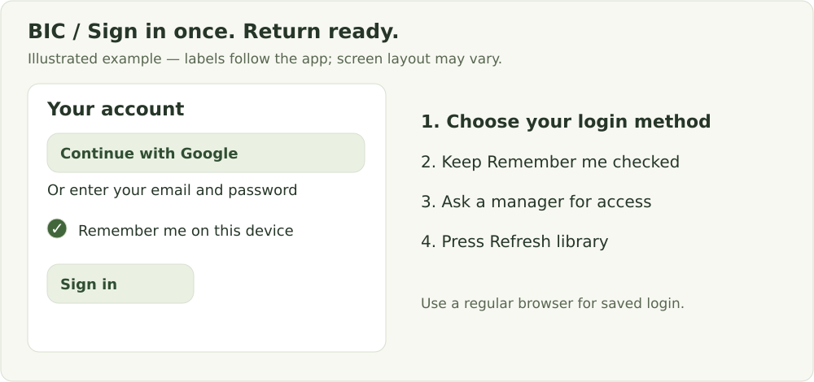
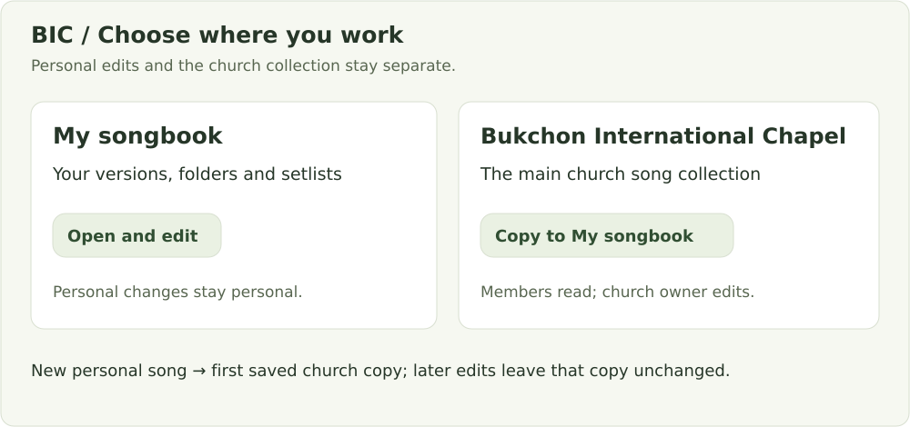
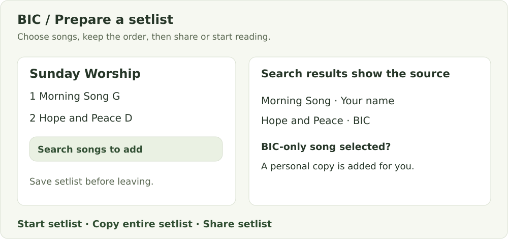
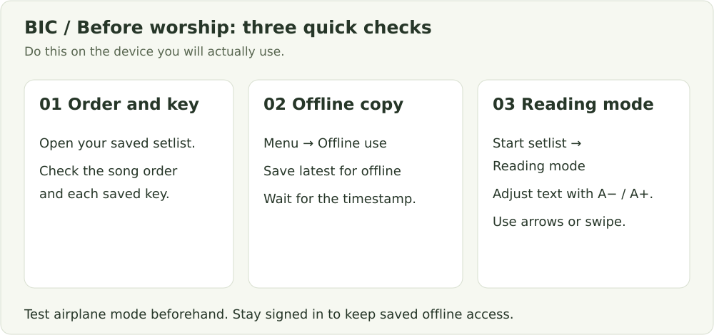

# BIC Worship DB — Start here

A first-time user guide. Updated November 3, 2026; includes setlist draft recovery, visual chord positioning and offline checks.

Open [BIC Worship DB](https://bic-songbook.netlify.app/). Installing an app is optional.

Prefer an illustrated web page? After deployment, open [the start-up guide](https://bic-songbook.netlify.app/start-guide.html).

## 1. Sign in and get access



*Workflow illustration, not an app screenshot; layouts vary by device.*

1. Open [bic-songbook.netlify.app](https://bic-songbook.netlify.app/) in your browser. Installing the app is optional.
1. Choose **Continue with Google**, or **Create an account** to use email and a password. Confirm your email if asked.
1. Keep **Remember me on this device** checked on your own device. Uncheck it on a shared device.
1. Choose your **@ID** when prompted and press **Save ID and continue**. This submits your access request. Wait for a manager or the church account to approve it, then press **Check approval**.

Already have an account? Use the same login method and email. Private browsing or clearing site data can forget your login.

## 2. Choose a songbook



*Workflow illustration, not an app screenshot; layouts vary by device.*

**My songbook** is your workspace: edit your arrangements, organize folders and prepare setlists. **Bukchon International Chapel** is the church collection. Members can read it and use **Copy to My songbook** to make an editable personal version.

A new personal song’s first saved version is also added to the church collection unless that title already exists there. Later personal edits do not change the church copy. A manager approves access but cannot edit church songs. The church account manages only the church collection.

## 3. Add a song or paste a chord sheet

1. Open **My songbook → + Add Song**, or choose **Add new song** while planning a setlist.
1. Paste the chart. Choose **Chords above lyrics** for a chord sheet, or **Formatted chart** for source with inline chord markers.
1. Check the title and key, enter an artist if you want, and save. The app converts chord sheets and flags lines that may need a closer look.

```text
**Morning Song**

# Verse 1
G             D
A new day is here
```


In the editor, chords use braces, such as `{G}A new day is {D}here`. Start a section line with `# ` followed by its title, for example `# Verse 1`, `# Chorus`.

You can keep a separate personal arrangement under the same title. In the setlist planner you can also use an existing chart.

## 4. Find and organize songs

Use search for a title or artist. My Setlists, My folders and Song filters are collapsible sections that start closed. Open Song filters for the first-letter buttons, Author / singer filter and favorites. Active filters stay visible when the section is closed; Clear song filters removes them. **All · A–Z · #** filters titles by their first character; **#** includes numbers, symbols and non-Latin titles. Cards adapt to your screen.

Open a folder card to see its songs. Use the **My Songbook** breadcrumb to return to all songs. Create a folder under **New folder**; open a song and choose **Add to folder**. Select an existing folder and **Add song to folder**, or choose **Create folder and add song**. Use **Open folder** afterward to visit it. Folder **⋮** offers Rename and Delete. Deleting a folder keeps its songs in **All songs**.

## 5. Prepare your first setlist



*Workflow illustration, not an app screenshot; layouts vary by device.*

1. In **My songbook → My Setlists**, choose **New setlist** and enter a name.
1. Search by song title or artist. Personal results show your name; church results show **BIC**. Your personal version takes priority when the song is in both places.
1. Select songs in service order. Selecting a BIC-only song automatically adds a personal copy to your songbook.
1. Use **↑ / ↓** to reorder, then **Save setlist**. You return to the cards. Select the title to edit or the green play button to read and print.

You can also open a personal song → **Add to setlist**, then choose an existing list or **Create setlist with this song**. Each account can keep 25 personal setlists. At the limit, you can replace the oldest, choose another to replace, or cancel. Deleting a setlist keeps the songs but ends its outgoing shares.

Unsaved setlist names and song order are saved in this browser. After returning, open **My Setlists → Recover setlist draft**, review and save. If the original changed or was deleted, recovery offers a new independent list. This also covers new names entered from **Add to setlist** on a song. Save, confirmed Cancel/Discard and sign-out clear drafts. Keep Remember me checked for recovery after closing the browser; drafts never sync between devices.

## 6. Share a setlist

1. Choose **Copy setlist link** after saving, or use the chain icon on its card.
1. Send the link to your team. Each person opens it with an approved songbook account and can find it later under **Shared with me**.
1. To close the link, open **Share options → Turn off link** in the reader.

Recipients can read the live set and keep their own notes and capo settings. Your saved changes update what they see.

**Want your own arrangement?** On a received list, choose **Save to my setlists** and keep or change its name. This makes an independent copy. Your edits will not change the sender’s list, and their later changes will not update your personal copy. The original received list stays live separately.

## 7. Read during worship and prepare offline



*Workflow illustration, not an app screenshot; layouts vary by device.*

1. Select the green play button to open the full set. Choose **Lyrics** or **Chords** in the reader.
1. Text starts at 16px by default. Reading mode checks the current size, then decreases it 1px at a time only if needed. It stops as soon as lines fit, with a 12px automatic minimum. Use **A− / A+** for text size afterward. If a line must wrap, it breaks at spaces; chord markers inside a word stay with that word. Use page arrows or swipe. In the setlist reader, scroll or use Jump to song.
1. Transpose changes the displayed key. To make it permanent in your editable personal song, choose **Save in X as base key**. Transpose then resets to zero.
1. Open the setlist while online so the app saves the latest copy on this device.
1. Stay signed in. Test airplane mode and reopen the setlist on that device before the service.

Offline mode supports reading, transposing and page turning. Editing, sharing and new login need internet. Received lists use their last saved version. A ready label confirms the current saved copy, not future changes on the server. Browser storage can still be cleared, so test airplane mode before each service. Check the screen-awake status in reading mode; device settings may still release it.

## 8. Copy, back up and recover

**Copy → Copy lyrics** copies words without chords; **Copy with chords** includes the displayed chords. **Copy entire setlist** copies songs in saved order.

Use **Complete backup / restore → Download complete backup** to keep a separate backup. It includes songs, folders, personal setlists and favorites. It excludes received setlists, history and access permissions. Restore adds copies rather than replacing your current work.

For an accidental edit, at the bottom of a song page, open **Song history** and preview an earlier saved version before restoring. Use **Recover deleted songs** on the song list for available deleted-song history. Unsaved song fields and unconverted pasted chord sheets are saved as local drafts while you edit. After returning to the same songbook, choose **Recover draft**, review it and save. If the original changed or was deleted, recovery offers a new song instead. **Cancel** or **Discard draft** removes it. Drafts do not sync across devices and are cleared on sign-out. Keep **Remember me** checked for recovery across browser sessions; unchecked sessions keep drafts only in that tab. If browser storage is blocked or full, the editor warns that the draft is only in memory. Save regularly and keep backups.

## Quick troubleshooting

**I see “Awaiting access.”**
Ask a manager to approve your account email or ID, then Refresh library.

**I cannot edit a church song.**
That is expected for personal accounts. Choose Copy to My songbook and edit your copy.

**A friend cannot see my shared setlist.**
Check that the link is active and that they signed in with an approved account.

**I cannot edit while offline.**
Reconnect first. Offline mode is for reading saved copies.

**The app looks out of date.**
Connect to the internet and refresh after a successful deployment. If it persists, close and reopen it.

**I need to sign in again.**
Check Remember me and use the same regular browser and website address. Avoid private mode and settings that clear site data on exit.


## Song sorting (October 22)

Open **Song filters → Sort songs**. Choose **Title A–Z / Z–A**, **Date added — newest / oldest first**, or **Last edited — newest / oldest first**. Sorting rearranges all matching songs; it does not hide songs by date. This replaces the October 21 date-range controls. Sorting works with search, folders, first-letter, artist and favorites filters. The active summary remains visible when collapsed, and **Clear song filters** resets sorting to Title A–Z too. Received setlists keep their owner's order.

Older songs without a recorded added date appear last in both date-added directions. New songs record their added date; last edited uses the server timestamp, including saved folder/key changes. Refresh online to update offline copies. The existing added-date database change remains applied; no new SQL step is needed.


## Joining with an @ID and pending access requests (October 28)

After first sign-in, personal accounts without a account ID see **Choose your @ID**. Choose a unique 3–24-character ID using letters, numbers or underscores, then **Save ID and continue**. Existing personal accounts without IDs are prompted too; IDs remain changeable from Menu → My account ID. The church owner is exempt. An existing saved offline session remains readable without an online onboarding check.

For an unapproved account, saving the ID also submits an access request. The waiting screen shows **Awaiting approval** and **Check approval**. Users who already have an ID but have not submitted can choose **Request access**. A declined user can explicitly **Request access again**; simply refreshing does not resubmit a declined request.

Managers and the church owner open **Menu → Pending access requests (count)**. Expand it to see the sign-in display name, @ID (or ID not chosen yet), email and request time. **Approve** grants ordinary member access; **Decline** asks for confirmation and leaves the login account intact without library access. It does not delete songs or accounts. No email is sent. Check the email/ID: display names are supplied by the sign-in account and are not verified identities.

Existing confirmed accounts without access were included in the pending queue. Approved accounts stay out of it. Requests refresh on focus and every 30 seconds while visible; users can also refresh manually. Members cannot read the queue or approve requests. Stale/repeated decisions are rejected server-side and cannot demote an existing manager or owner. Existing manual access management and the Show/Hide registered-accounts list remain available in Menu.

The database change has already been applied. `database/registration-requests.sql` is reference only; no manual SQL step is needed. Regression SQL in `tests/registration-access.sql` uses temporary test accounts in a transaction that rolls back. This update does not change church song-editing permissions.


## Menu layout, library sorting and offline-copy recovery (October 29)

**Menu:** Pending access requests is now inside Menu for managers and the church owner. Show registered accounts includes each person's @ID, or a dash when none is set (including the church owner). After opening a songbook, the Menu order is Export songs only / Import songs, then Complete backup / restore, then Recover deleted songs. Saved-version Song history stays on its song page.

**Sort setlists and folders:** open My Setlists or My folders, expand its Sort control, and choose Name A–Z / Z–A, Date added newest / oldest, or Last edited newest / oldest. This rearranges cards only, never the songs within a setlist. Missing dates sort last. Folder timestamps begin with this update; existing unknown folder dates remain unknown. Folder last-edited tracks folder renaming, not edits to songs inside it. Older setlist creation dates may be approximate, as previously documented. Refresh online to update device-local copies with dates.

**Recover the last offline save:** inside Complete backup / restore, choose Preview last offline save. It reads this account's latest snapshot from this device and shows its saved time, songbook, song/folder/setlist/favorite counts and a song preview. Review it, then Restore offline save as copies and confirm. Current work is kept. IDs are remapped, setlist order/repeats and folder memberships are preserved, and restored folders/lists get recovery names. Missing setlist-song references are reported and skipped. Received setlists, access permissions and history are not in this offline recovery copy. Only the current songbook is restored; church restoration remains owner-only. Restore requires internet and respects the 25-personal-setlist limit; an invalid/over-limit import rolls back. Repeated restores create duplicates.

This is the latest snapshot still stored, not an archive: online refreshes can replace it, and signing out or clearing site data can remove it. A preview captures a fixed copy so later background refreshes do not alter what you confirm. Keep downloaded complete backups and use Song history for earlier versions. The existing file-based complete restore still adds copies too.

Database changes for folder dates and the manager-only account-ID listing are already applied. `database/menu-library-dates.sql` is reference only; no manual SQL step is needed.


## Setlist default order and reading content (November 3)

Personal setlist cards now default to **Date added — newest first**. You can still choose any other sort. Folder cards keep their existing **Name A–Z** default. Neither setting changes the order of songs inside a setlist.

When opening **Reading mode**, choose **Lyrics only** or **Lyrics + chords**, or cancel. Lyrics only keeps the lyrics and section labels and removes chord spacing from the page layout. **Reading content** also lets you switch while reading; pages are recalculated for the chosen layout. The choice applies to the whole setlist. It affects display only, including saved offline reading, and never edits stored arrangements or transpositions. No database change is needed.


## Horizontal song flow and linked sections (November 3)

Add/Edit Song now has a **Song flow** panel above the main editing fields. Sections are compact horizontal items that wrap on small screens. Existing [Verse 1] / [Chorus] headings and legacy # headings are recognized; chord-only lines remain chords. Opening text without a heading is kept at the start, with an option to name it and include it in the movable flow.

Drag a handle, or select a section and use the move arrows. The + insertion markers choose exactly where to add a new section or repeat an existing one. Select a section for its lyrics/chords, name, insert-after and remove controls. Removing one occurrence keeps the others. **Undo last flow change** reverses the latest flow edit while its result is still current; later edits in another editor disable that stale undo. All changes remain a draft until Save.

Repeated section names with matching text are **linked**. Editing their lyrics/chords through the section editor, regular text editor or visual chord-position editor updates matching occurrences. Rename a particular occurrence, for example **Chorus 2**, before giving it a different arrangement. Copying/importing a complete chord sheet preserves its separate versions for review rather than silently forcing them to match.

Existing sections with the same name but different lyrics/chords are highlighted and stay unchanged. Resolve them before saving: **Keep variations as separate sections** gives distinct numbered labels while keeping every version, or **Use selected version for all ... sections** explicitly replaces the differing versions in the draft. Renaming individual occurrences also works. Equal labels are compared without case differences and repeated spaces; differing final blank lines alone do not create conflicts.

Flow edits are included in browser-local song draft recovery. Saving retains the complete expanded song text, so existing reading, lyrics-only mode, transposition, copying, history, backups and live setlist sharing continue to use the arrangement. No database migration or new backup format is needed. This combined patch also includes the earlier November 3 newest-setlist default and lyrics/chords reading choices; folders remain A–Z by default.
